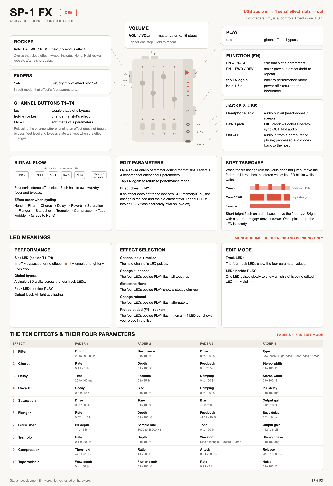

# SP-1 FX

SP-1 FX is custom firmware for the Teenage Engineering / Kano SP-1 Stem Player. It turns the SP-1 into a battery-powered, screenless, real-time stereo multi-effects processor with four serial effect slots. Each slot has one effect chosen from Filter, Chorus, Delay, Reverb, Saturation, Flanger, Bitcrusher, Tremolo, Compressor, Tape wobble, or None. Each slot has its own wet/dry level, a bypass switch, and four parameters that the four faders control in edit mode. Audio comes in over USB from a computer or phone and goes out to the headphone jack or the speaker.

This is an unofficial hobby project. It is not affiliated with, endorsed by, or supported by Teenage Engineering or Kano.

## Status

**Development firmware. Only bring-up images have run on the owner's hardware, and nothing here is production-ready.** The evidence labels follow `docs/STATUS.md`.

**Newest image: `sp1fx-v1-rc1.bin`, the integrated firmware (`firmware/app/zephyr_sp1fx`). Built and host-tested, NOT RUN ON HARDWARE yet.** It combines USB audio + effects, buttons/faders/LEDs, VOL+/VOL- volume (2 dB steps, saved), the companion protocol on the USB serial port, settings saved to internal flash (0xFD000-0xFEFFF), and the sync jack (off by default, untested with gear). Owner test plan: `docs/BRINGUP_SP1FX.md`.

**Verified on hardware** (owner-observed, spare unit, 2026-11-24; see `docs/STATUS.md`):

- Minimal heartbeat, tone (codecs, I2S, channel order), controls (all buttons, faders, effect and preset cycling, soft takeover, edit mode, volume steps, power off) and sync (serial log only, no gear) bring-up images.
- USB audio v3 (`zephyr_usbaudio`, optimised DSP): Mac audio through the engine, the six presets at about 50 % CPU, no crashes (reported by the lead). Ambient tripped the old overload guard on short spikes; the guard is changed in v1-rc1 (untested on hardware).

**Source-only or simulated** (host tests, `make test`): the 4-slot engine and 10 effects, controls logic, persistence journal and its erase scheduling, the binary protocol, factory presets, the simulator, the companion web app (never run against a real SP-1).

**Untested:** everything that is new in v1-rc1 (see above), sync with real gear, latency, headphone/speaker switching, iPhone/iPad/Android hosts, Windows (expected not to work).

**Known issues / limits:** replacing an effect cuts the old tail; saturation and bitcrusher alias at high settings; soft-takeover thresholds are guesses; only 8 monochrome LEDs; the Mac cannot control the volume over USB (use VOL+/VOL-); Windows is not supported (explicit-feedback UAC2 without Tape Looper's Windows patch).

## Controls guide



Quick-reference guide: [PDF](docs/guide/sp1fx-guide.pdf) | [HTML source](docs/guide/sp1fx-guide.html)

Text summary of the controls, for readers who cannot see the image:

- **Rocker (FWD/REV), with T1-T4 held:** next or previous effect for that slot. The cycle wraps through None. Holding the rocker repeats.
- **Faders 1-4:** wet/dry mix of slots 1-4 in performance mode. In edit mode, the same faders set that effect's four parameters.
- **T1-T4 tap:** toggle that slot's bypass.
- **FN + T1-T4:** enter edit mode for that slot. **Tap FN again** to return to performance mode.
- **FN + FWD/REV:** previous or next preset. Holding repeats.
- **PLAY tap:** global bypass. A single LED walks across the track LEDs while bypassed.
- **FN hold 1.5 s:** power off, return to the bootloader.
- **VOL- / VOL+:** master volume, 2 dB per press (-60 to 0 dB), shown as a bar on the PLAY-side LEDs. Holding repeats. Saved. (The guide image still says 16 steps; the HTML source is updated.)
- **Soft takeover:** when a fader changes role, its value does not jump. Its LED blinks while you move it toward the stored value. A bright flash on a dim base means move up. A bright blink with a dark gap means move down. A steady LED means picked up.
- **LEDs beside PLAY:** output level, or a flashing row when a change is refused (for example, an effect that does not fit the DSP memory or CPU budget).

## How it works

- **Input:** the SP-1 is a USB device. A Mac or phone sends stereo audio over USB Audio Class 2 (UAC2) at 48 kHz, 16-bit. The SP-1 has no analog audio input: its codec has no data path back to the MCU, and the MCU has no I2S data-in pin (`docs/PHASE0_REPORT.md`, source findings).
- **Processing:** the nRF52840 (Cortex-M4F, 64 MHz) runs a 4-slot serial effect chain in 64-frame blocks. The engine has a 150 KiB effect memory pool and rejects configurations that do not fit the memory or CPU budget.
- **Output:** processed audio goes out over I2S to the headphone codec (CS42L42) or the speaker amplifier (TAS2505). Image B also returns the processed audio to the host as a second USB input device.
- **Sync:** the second 3.5 mm jack is a digital **output** only: MIDI clock and Start/Stop on the ring, Pocket Operator sync pulses on the tip. It does not carry audio (`docs/ADR-001-audio-routing.md`).
- **Control:** a companion web app talks to the device over the USB serial port with the Web Serial API. It is used for presets, tempo and sync settings, and to view status. The protocol is specified in `docs/PROTOCOL.md`. The companion is a static page with no dependencies (`companion/README.md`).

Routing decision: USB audio in, headphone and speaker out, digital sync out (`docs/ADR-001-audio-routing.md`). Standalone analog input is not possible on this hardware.

## Repository layout

```
AGENTS.md              rules for contributors and agents
Makefile               host build: DSP library, simulator, C tests (make, make test)
firmware/
  dsp/                 effects and the 4-slot engine (plain C99, no Zephyr headers)
  controls/            debounce, gestures, soft takeover, controller, LED renderer
  audio/               USB audio core (ring, feedback) and FX profiling core
  protocol/            binary protocol, device side
  storage/             versioned config record and power-loss-safe journal
  drivers/             ladder/fader, LEDs, sync, MIDI out, crash dump (Zephyr side)
  app/                 Zephyr apps: zephyr_sp1fx (integrated firmware), zephyr_min,
                       zephyr_tone, zephyr_controls, zephyr_sync, zephyr_usbaudio,
                       zephyr_usbaudio_io, zephyr_fxprof; app_logic.c (host-tested
                       save/console decisions)
  boards/              SP-1 board definition (from Tape Looper, MIT) and licences
  scripts/             build_firmware.sh, build_controls.sh, build_sync.sh, check_image.py
  west.yml, west-lock.json   pinned Zephyr and module versions
companion/             Web Serial companion app and its Node tests
presets/               factory preset JSON and the generator for factory_presets.h
simulator/             WAV in, WAV out through the real engine (build/sp1fx_sim)
tests/                 C test suites (test_*.c) and golden-frame generator
tools/fxprof_emu/      host emulator for effect cost profiling
docs/                  status, build, protocol, ADRs, bring-up notes, guide
build/                 generated (git-ignored)
```

## Build and test

Host build and tests (no hardware needed):

```sh
make              # builds build/sp1fx_sim and the C tests
make test         # builds and runs every tests/test_*.c suite
build/sp1fx_sim --list
build/sp1fx_sim in.wav out.wav --slot 1=filter --param 1.1=800 --slot 2=delay --wet 2=0.4 --tail 2
```

Companion tests (Node 22):

```sh
cd companion
node --test tests/*.test.mjs     # or: npm test
npm run serve                    # static server on http://localhost:8137
```

Firmware (Zephyr) build. This needs an Apple Silicon Mac, Homebrew Python 3.10+, and about 1.5 GB of disk. See `docs/BUILD.md` for the full prerequisites and pinned versions (Zephyr v4.3.1, SDK 0.17.4):

```sh
firmware/scripts/build_firmware.sh setup    # venv, pinned west workspace, SDK (SHA-256 checked)
firmware/scripts/build_firmware.sh          # clean build of zephyr_min, then check_image.py
firmware/scripts/build_firmware.sh repro    # two clean builds in different dirs, compares SHA-256
firmware/scripts/build_firmware.sh verify   # checks commit pins and SDK version only

firmware/scripts/build_firmware.sh --app zephyr_tone
firmware/scripts/build_firmware.sh --app zephyr_usbaudio
firmware/scripts/build_firmware.sh --app zephyr_usbaudio_io
firmware/scripts/build_firmware.sh --app sp1fx              # integrated firmware (zephyr_sp1fx)
firmware/scripts/build_firmware.sh --app sp1fx repro        # two clean builds, byte-identical check
```

The controls and sync images have their own scripts, `firmware/scripts/build_controls.sh` and `firmware/scripts/build_sync.sh`. The `release` mode of the sync script copies its output to the staging folder described below. The build scripts have no flash, runner, debug or serial step.

## Flashing

**Safety first.**

- **Nothing in this repository flashes anything, and the firmware is never flashed automatically.** Flashing is a manual step that the owner does.
- Flashing replaces the current app. Check the image name and SHA-256 before you flash.
- Never write to the bootloader (0x00000-0x1FFFF), the Bluetooth module, eMMC, or the storage page (0xFF000). The images are linked to the app slot at 0x20000 and `check_image.py` enforces that. Do not erase storage. The integrated firmware (`sp1fx-v1-rc1.bin`) itself writes only its two settings pages 0xFD000-0xFEFFF, inside the app slot and outside its image (`check_image.py --reserve`, `docs/ADR-003-storage.md`).
- The SP-1 has no reset pin. An app that does not feed the watchdog (every 5 s) boot-loops until the bootloader is re-entered. An app that cannot reach SYSTEM_OFF can only be recovered through the bootloader key combination.
- **Keep a recovery image ready.** The Tape Looper release image (`RECOVERY-tape-looper-from-repo.bin`, SHA-256 `e73e3786...badbf`) is the known-good fallback. The tone and minimal heartbeat images have also booted on the owner's unit.
- Start with the computer volume low and the headphones off your ears. USB audio images have a fade-in and a digital trim, but the analog gains are not yet measured.

Procedure:

1. Open desktop Chrome (WebUSB) at <https://solderless.engineering>.
2. Turn the SP-1 off. Hold **T1 + T4** while you connect USB, and release when **T1 lights**. The device is now in the TE bootloader.
3. Check the image against the staged checksums, then flash it from the Solderless page.
4. To recover from a bad image, repeat step 2 and flash a known-good image.

Staged images are kept outside the repository, in `~/spfx/flash-ready/`. They are not in git. The build scripts produce them (copies from `build/firmware/...` with SHA-256 checked). Verify with `shasum -a 256 -c SHA256SUMS` in that folder.

| Image | Purpose |
|---|---|
| `sp1fx-min-heartbeat.bin` | Minimal heartbeat and power-off image. Boots and blinks LED 1. |
| `sp1fx-tone.bin` | Audio bring-up: quiet test tone (left low, right high). Confirmed on the owner's unit. |
| `sp1fx-controls.bin` | Buttons, faders, LEDs, effect and preset cycling, with the engine in the loop. Confirmed on the owner's unit. |
| `sp1fx-sync.bin` | MIDI clock and PO sync output. Serial log confirmed. Real gear pending. |
| `sp1fx-usbaudio-in.bin` (v1) | USB audio in, A. Crashes on the first preset change. Superseded. |
| `sp1fx-usbaudio-in-v2.bin` | USB audio in, A, v2 (crash mitigations and crash dump). Not flashed yet. |
| `sp1fx-usbaudio-io.bin` (v1) | USB audio in and return to host, B. Not run on hardware. Superseded. |
| `sp1fx-usbaudio-io-v2.bin` | USB audio in and return to host, B, v2. Not flashed yet. |
| `sp1fx-usbaudio-in-v3.bin` | USB audio in, A, v3 (optimised DSP, overload guard). Runs on the owner's unit (presets ~50 % CPU). |
| `sp1fx-v1-rc1.bin` | **Integrated firmware v1 release candidate 1.** Not run on hardware yet. Test plan: `docs/BRINGUP_SP1FX.md`. |
| `RECOVERY-tape-looper-from-repo.bin` | Tape Looper release, recovery only. Not built from this repository. |

Bring-up procedures and pass/fail checklists are in `docs/BRINGUP_SP1FX.md` (integrated firmware), `docs/BRINGUP_TONE.md`, `docs/BRINGUP_CONTROLS.md`, `docs/BRINGUP_SYNC.md` and `docs/BRINGUP_USBAUDIO.md`.

## Credits and licences

- **Tape Looper** by chattock (MIT), `sp1-tape-looper` at commit `0359372e`. The SP-1 board definition is a verbatim copy. The CS42L42 and TAS2505 codec code and the ladder, fader and LED handling are adapted from it. Each adapted file keeps its licence header.
- **Tim Knapen's SP-1-dev** (MIT). Pin map, hardware documentation, and the CS42L42 init sequence the codec code is based on.
- **Zephyr RTOS** (Apache-2.0), v4.3.1, with its modules (CMSIS, Nordic HAL, MIT and BSD-licensed parts). These are downloaded at build time and not redistributed here. Built images contain Zephyr code and carry those notices.
- **Teenage Engineering and Kano** hardware. The SP-1 hardware, its name and its branding belong to their owners.
- **Bluetooth firmware is not redistributed.** The Infineon radio image and its SDK are not part of this project and are not used by it.
- Tape Looper's UAC2 Windows patch is not applied.

Full list of upstream commits, licences, research references and open reviews: [THIRD_PARTY_NOTICES.md](THIRD_PARTY_NOTICES.md).

The project's own licence has not been chosen yet. Until one is added, all rights are reserved by the author.
